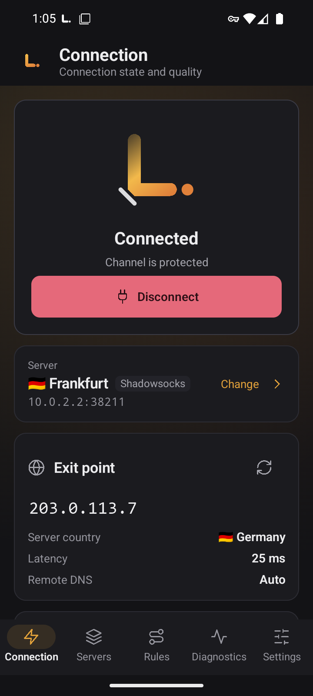
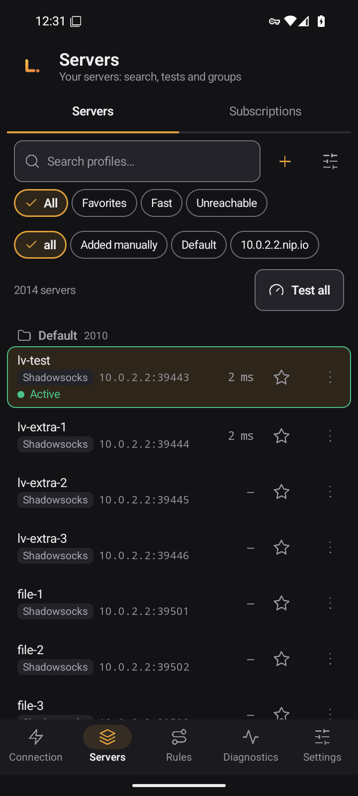
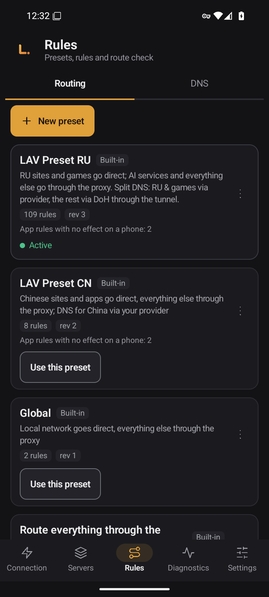
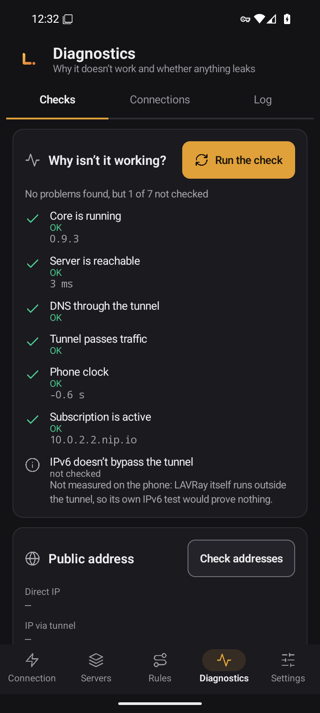
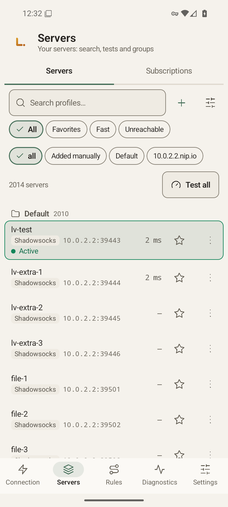
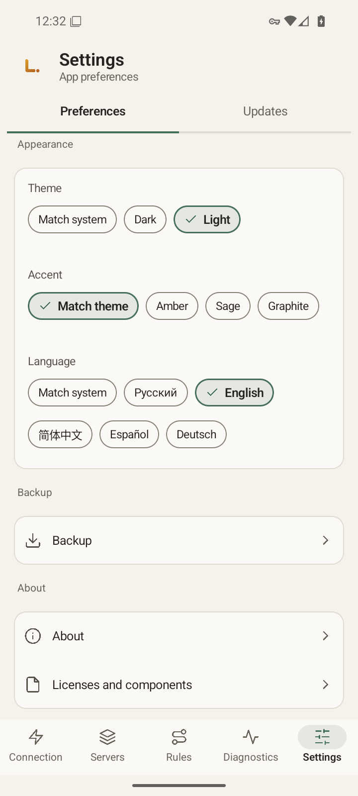

# LAVRay für Android

[Русский](README.md) · [English](README.en.md) · [中文](README.zh.md) · [Español](README.es.md) · **Deutsch**

*Dies ist eine Übersetzung der russischen README. Die Versionshinweise (Release Notes) sind auf Russisch.*

**LAVRay** für Android ist ein VPN-Client fürs Smartphone. Es ist eine native App in Kotlin und Jetpack Compose auf dem gleichen Go-Core wie [LAVRay für Windows](https://github.com/anatolijlaptev1991-ctrl/lavray-windows): gleiche Namen, gleiche Routing-Sets, gleiche Bildschirme und gleiche Farben. Die App verbindet sich mit deinen Servern und Abos und sendet dem Abo-Anbieter standardmäßig keine Daten über dein Gerät.

<p align="center">
  
  
  
</p>
<p align="center">
  
  
  
</p>

*Die Screenshots stammen von einem Emulator, die Oberfläche ist auf Englisch.*

> **Stand: Version 0.9.3, noch nicht auf einem echten Smartphone getestet.** Die App wurde auf einem Android-16-Emulator (x86_64) gebaut und geprüft. Eine Checkliste für den Test auf dem Smartphone steht in [docs/PHONE-CHECKLIST.md](docs/PHONE-CHECKLIST.md) (Russisch).

## Funktionen

- **Server und Gruppen:** Suche, Favoriten, Filter „Schnelle“ und „Unerreichbar“, Sortierung, Verschieben zwischen Gruppen, Kopien und ein QR-Code für jeden Server.
- **Abos** mit zeitgesteuerter Aktualisierung und Rückkehr zum letzten funktionierenden Stand.
- **Import:** Link, Zwischenablage, QR-Code (Kamera oder Bild) und Datei. Links wie `vless://`, `vmess://`, `trojan://`, `ss://`, `hy2://`, `tuic://` lassen sich aus einer anderen App in LAVRay öffnen oder über „Teilen“ senden. Es wird erst importiert, wenn du bestätigst.
- **Latenztest** für alle Server und ein URL-Test.
- **Routing-Sets:** „Global“, „Alles durch den Proxy“, „Alles direkt“, **LAV Preset RU** (Revision 3, standardmäßig aktiv: russische Seiten und Spiele direkt, alles andere über den Proxy) und LAV Preset CN. Eigene Sets, Import und Export sowie eine Prüfung, wohin eine Adresse geroutet wird.
- **DNS**, **Verbindungen**, **Protokoll**, **Statistik** und der Bildschirm „Warum funktioniert es nicht?“.
- **Tunnel pro App:** alle Apps, nur ausgewählte oder alle außer ausgewählten.
- **Automatisches Verbinden nach dem Neustart** mit dem zuletzt genutzten Server und Unterstützung für das systemweite Always-on-VPN.
- **Sicherung** in eine verschlüsselte Datei über die Dateiauswahl des Systems.
- **Fünf Oberflächensprachen** (Русский, English, 中文, Español, Deutsch), helles und dunkles Design, mehrere Akzentfarben.

Die Protokolle entsprechen der Desktop-Version: VLESS (auch REALITY), VMess, Trojan, Shadowsocks, Hysteria2, TUIC, SOCKS, HTTP.

---

## Herunterladen

Die APKs erscheinen auf der Seite [Releases](https://github.com/anatolijlaptev1991-ctrl/lavray-android/releases), sobald die erste Version veröffentlicht ist. Für jede CPU-Architektur gibt es eine eigene Datei:

| Datei | Wofür | Dateigröße |
|---|---|---|
| `LAVRay-<Version>-arm64-v8a.apk` | fast alle aktuellen Smartphones und Tablets | 20,65 MB |
| `LAVRay-<Version>-armeabi-v7a.apk` | alte 32-Bit-Geräte | 21,24 MB |
| `LAVRay-<Version>-x86_64.apk` | Emulatoren und Chromebooks | 21,97 MB |
| `SHA256SUMS` | Prüfsummen | — |

Wenn du unsicher bist, nimm `arm64-v8a`. Die Größen stammen aus [docs/MEASUREMENTS.md](docs/MEASUREMENTS.md) (Russisch).

**Datei prüfen.** Lade die APK und `SHA256SUMS` in denselben Ordner:

```bash
sha256sum -c --ignore-missing SHA256SUMS      # Linux, macOS (unter macOS: shasum -a 256 -c)
```

```powershell
Get-FileHash .\LAVRay-<Version>-arm64-v8a.apk -Algorithm SHA256   # Windows: mit der Zeile in SHA256SUMS vergleichen
```

**Signatur.** Release-APKs werden mit dem Schlüssel des Eigentümers signiert, wie in [docs/SIGNING.md](docs/SIGNING.md) (Russisch) beschrieben. Ein Update lässt sich nur über eine vorhandene Installation einspielen, wenn es dieselbe Signatur trägt.

**Voraussetzungen:** Android 8.0 oder neuer (minSdk 26), ARM-Prozessor (64 oder 32 Bit) oder x86_64.

---

## Schnellstart

1. **APK installieren.** Erlaube die Installation aus der gewählten Quelle (Browser, Dateien), öffne die Datei und bestätige.
2. **Server hinzufügen.** „Verbindung“ → „Server hinzufügen“ oder „Server“ → Symbol „+“. Füge einen Server- oder Abo-Link ein, scanne einen QR-Code mit der Kamera, wähle ein Bild mit QR-Code oder eine Datei. Vor dem Import siehst du, was hinzugefügt wird.
3. **Verbinden.** „Verbindung“ → „Verbinden“. Ab Android 13 fragt die App zuerst nach der Benachrichtigungsberechtigung (das VPN läuft als Vordergrunddienst mit einer Benachrichtigung), danach erscheint der VPN-Zustimmungsdialog: Bestätige beides. Nach dem Verbinden zeigt der Bildschirm Land und Adresse des Ausgangs, die Leak-Prüfung und die Geschwindigkeit.
4. **Routen prüfen.** LAV Preset RU ist bereits aktiv: Russische Seiten öffnen direkt, alles andere läuft über den Server. Ein anderes Set wählst du unter „Regeln“.
5. **Automatisch verbinden.** „Einstellungen“ → „Start“ → „Beim Start des Telefons verbinden“ (standardmäßig aus). Details und Grenzen stehen weiter unten.

---

## Bedienung

### Server und Abos

- „Alle testen“ misst die Latenz. Im Ansichtsmenü gibt es den „URL-Test“: Über jeden Server wird eine echte Seite geöffnet. Die aktuelle Verbindung bleibt während der Tests bestehen.
- Servermenü: „Verbinden“, Favorit, „Link kopieren“, „Link teilen“, „QR-Code anzeigen“ (der Link enthält Schlüssel, die App warnt dich), „Duplizieren“, „In Gruppe verschieben…“, Reihenfolge, Löschen. Mit langem Tippen wählst du mehrere Server aus.
- Abos: „Abos“ → Link hinzufügen, dann „Aktualisieren“. Ein fehlgeschlagenes Update löscht die alten Server nicht, und du kannst es „Zurücksetzen“.
- XHTTP-Links werden importiert, sind aber mit „vom Core nicht unterstützt“ markiert: Eine Verbindung darüber ist nicht möglich.

### Regeln und DNS

- Eingebaute Sets werden nie verändert: „Kopie anpassen“ legt deine eigene Kopie an, „Auf Original zurücksetzen“ stellt sie wieder her.
- „Route prüfen“ zeigt, wohin eine Domain oder IP mit dem aktiven Set geroutet wird.
- DNS: „Auto“ (passend zum aktiven Set), lokal, DoH, DoT und durch den Tunnel, eigene Server, FakeIP.

### Diagnose

- **Prüfungen** („Warum funktioniert es nicht?“): Core, Server, Tunnel, DNS, Uhrzeit, Abo.
- **Verbindungen:** jede Verbindung mit Adresse, Ausgang, Regel und Datenmenge, mit Suche, Pause und Schließen.
- **Protokoll:** „Kopieren“ und „Teilen“ liefern das Protokoll mit bereits verborgenen Passwörtern, UUIDs, Tokens und Abo-Adressen. Du kannst es einer Fehlermeldung beilegen.
- **Statistik:** Datenverkehr der Sitzung und insgesamt, nach Gruppe und nach Route.

### Tunnel pro App

„Einstellungen“ → „Tunnel“ → „Apps im Tunnel“: alle Apps, nur ausgewählte oder alle außer ausgewählten. LAVRay selbst bleibt immer außerhalb des Tunnels. Eine Änderung gilt ab der nächsten Verbindung.

### Einstellungen

Sprache, Design und Akzent, „Verbindung nach dem Verbinden prüfen“, IPv6 durch den Tunnel, MTU, Ausnahmen nach Adresse, Mux, Abkürzungen zu den Systemeinstellungen für Always-on-VPN und Akku, Sicherung, „Über LAVRay“ und Lizenzen. Der Tunnel läuft immer mit gVisor und standardmäßig mit MTU 9000, eine Stack-Auswahl gibt es in den Einstellungen nicht.

### Updates

Die Seite „Updates“ öffnet nur die Release-Seite. Die App fragt das Netz nicht nach neuen Versionen und aktualisiert sich nicht selbst: Lade eine neue APK herunter und installiere sie über die alte, deine Daten bleiben erhalten.

### Sicherung

„Einstellungen“ → „Sicherung“: alle Daten (Server mit ihren Passwörtern, Gruppen, Abos, eigene Sets, Einstellungen) in einer `.lavbk`-Datei unter deinem Passwort. Ohne das Passwort lässt sich die Datei nicht öffnen. Die Wiederherstellung ersetzt alle aktuellen Daten und verlangt, dass du das VPN vorher trennst.

---

## Autostart, Always-on und Unterschiede zwischen Geräten

- Schalte „Beim Start des Telefons verbinden“ ein: Nach einem Neustart verbindet sich die App mit dem zuletzt genutzten Server. Android sendet das Boot-Signal erst nach der **ersten Entsperrung** des Telefons.
- Ist das Telefon ohne Netz gestartet (zum Beispiel im Flugmodus), wartet die App still und verbindet sich, sobald ein Netz da ist. Es gibt keine Timer und kein Polling.
- Am zuverlässigsten ist das systemweite **Always-on-VPN**: „Einstellungen“ → „System“ → „Always-on-VPN“. Aktiviere dort LAVRay und, falls gewünscht, „Verbindungen ohne VPN blockieren“. LAVRay sieht diese Schalter nicht und kann sie nicht ändern. Startet das System die App, behandelt sie das als Always-on-Start und verbindet den zuletzt genutzten Server.
- Eine zwangsweise beendete App erhält das Boot-Signal erst, wenn du sie wieder öffnest.
- Herstelleroberflächen (Xiaomi/HyperOS, Huawei/HarmonyOS, Samsung, Oppo/Realme/OnePlus, Vivo) können den Autostart blockieren oder den Dienst bei ausgeschaltetem Bildschirm beenden. Nimm LAVRay dann in die Ausnahmen der Autostart- und Akkuverwaltung auf. Mehr dazu in [docs/PHONE-CHECKLIST.md](docs/PHONE-CHECKLIST.md) (Russisch).
- Nimmt dir eine andere VPN-App die Zustimmung weg, zeigt LAVRay die Benachrichtigung „VPN-Berechtigung erforderlich“: Öffne die App und bestätige erneut.

---

## Messwerte

Alle Zahlen stammen aus [docs/MEASUREMENTS.md](docs/MEASUREMENTS.md) (Russisch) und wurden **auf einem x86_64-Android-16-Emulator (2 vCPU) gemessen, nicht auf einem Smartphone**. Auf einem echten Gerät weichen sie ab.

| Messgröße | Wert (Emulator) |
|---|---|
| APK-Größe: arm64-v8a / armeabi-v7a / x86_64 | 20,65 / 21,24 / 21,97 MB |
| Kaltstart der Oberfläche, Median | etwa 1,26 s (1259,5 ms, 16 Starts) |
| Speicher des Prozesses `:vpn` im Leerlauf (verbunden, Bildschirm aus) | etwa 67 MB PSS |
| Wakelocks, Alarme und Jobs im Leerlauf | keine |
| „Verbinden“-Tipp bis zur ersten Antwort durch den Tunnel, Median | 844 ms (lokaler Testserver) |
| MTU 9000 gegenüber 1500, Durchsatz durch den Tunnel | 4,1-mal schneller im Download, 2,4-mal im Upload (Teststand im Emulator, kein echtes Netz) |

Nicht gemessen: Akkuverbrauch, Geschwindigkeit auf einem echten Smartphone, Betrieb auf arm64 und armeabi-v7a.

---

## Datenschutz

Viele Abo-Anbieter begrenzen die Zahl der Geräte anhand einer Kennung, die der Client sendet. **LAVRay sendet standardmäßig keine solche Kennung:** Die Abo-Anfrage enthält nur den User-Agent `LAVRay/<Version>`. Verlangt dein Anbieter eine HWID, schalte „Gerätekennung senden (HWID)“ in den Abo-Einstellungen ein: Gesendet wird eine zufällige, für diese Installation erzeugte Kennung, keine Daten deines Telefons.

Die Kamera dient nur zum Lesen von QR-Codes. Die Zwischenablage liest die App nur, wenn du das Importfenster öffnest. Die App-Auswahl listet nur Apps mit Starter-Symbol. Die eigene Android-Datensicherung ist für diese App abgeschaltet.

---

## Was noch nicht funktioniert

- **Kein Selbst-Update:** Neue Versionen installierst du von Hand von der Release-Seite.
- **Einige Desktop-Funktionen fehlen**, darunter der Server-Editor, der „Vollständige Test“ und der Assistent beim ersten Start. Die vollständige Liste mit Gründen steht in [docs/NOT-PORTED.md](docs/NOT-PORTED.md) (Russisch).
- **XHTTP-Transport:** Links werden importiert, der Core unterstützt ihn aber noch nicht.
- **Nicht auf einem echten Smartphone getestet.**

---

## Aus dem Quellcode bauen

Du brauchst JDK 21, das Android SDK (Plattform 36) mit NDK 28.2.13676358, Go (die Version aus `third_party/lavray/core/go.mod`) und Bash.

```bash
git clone --recurse-submodules https://github.com/anatolijlaptev1991-ctrl/lavray-android.git
cd lavray-android
bash scripts/build-core.sh        # Go-Core -> app/libs/lavray-core.aar (gomobile bind)
./gradlew assembleRelease         # APKs in app/build/outputs/apk/release/
```

Ein lokaler Build ist mit dem Debug-Schlüssel signiert und darf nicht weitergegeben werden. Releases baut `release.yml` bei einem Tag `v*`; der Schlüssel ist in [docs/SIGNING.md](docs/SIGNING.md) beschrieben. Aufbau des Codes: [docs/ARCHITECTURE.md](docs/ARCHITECTURE.md), Technologiewahl: [docs/STACK.md](docs/STACK.md) (beide auf Russisch).

## Fehler melden

[Erstelle ein Issue](../../issues/new/choose): was du getan hast, was du erwartet hast, was stattdessen passiert ist, Telefonmodell, Android-Version, Herstelleroberfläche, die Version von LAVRay („Einstellungen“ → „Über LAVRay“) und das Protokoll („Diagnose“ → „Protokoll“ → „Teilen“).

## Quellcode und Lizenz

Der App-Code (Kotlin, Compose) und der Core-Build liegen in diesem Repository. Der Go-Core und die Desktop-Oberfläche liegen in [lavray](https://github.com/anatolijlaptev1991-ctrl/lavray) und sind als Submodul `third_party/lavray` eingebunden (Tag v0.9.3).

Lizenz [GPL-3.0-only](LICENSE). LAVRay basiert auf nekoray/NekoBox (GPL-3.0) und sing-box (GPL-3.0 oder neuer).
