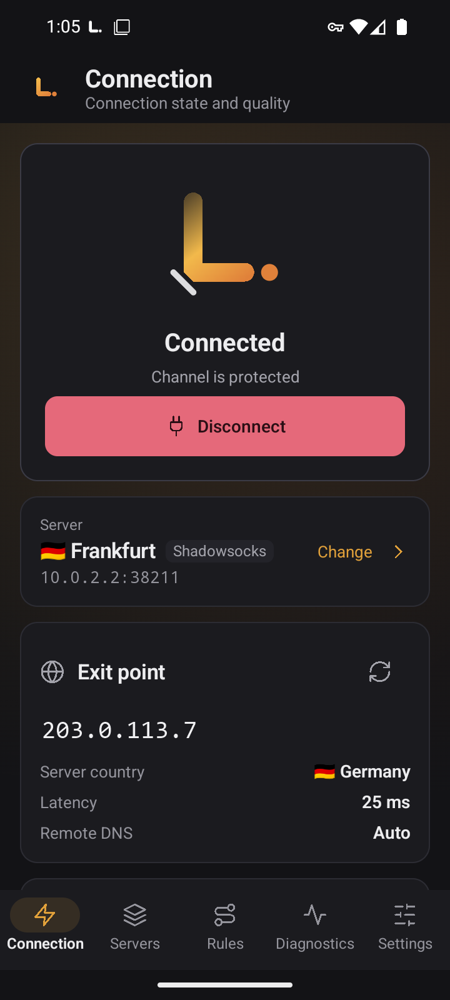
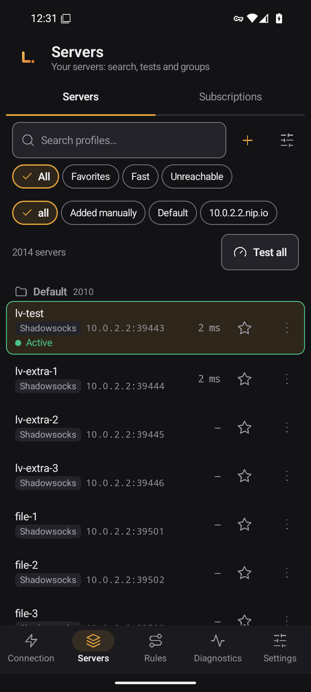
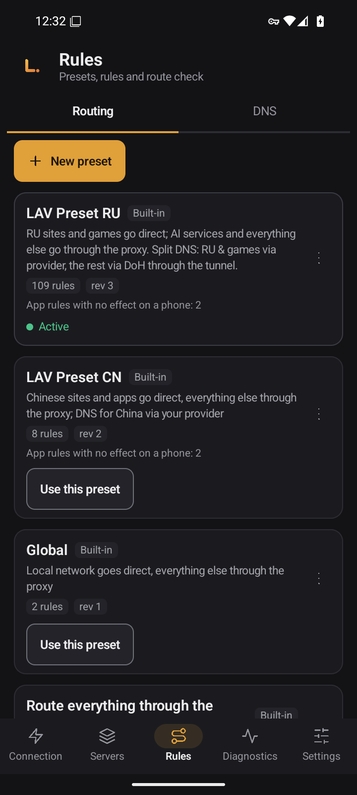
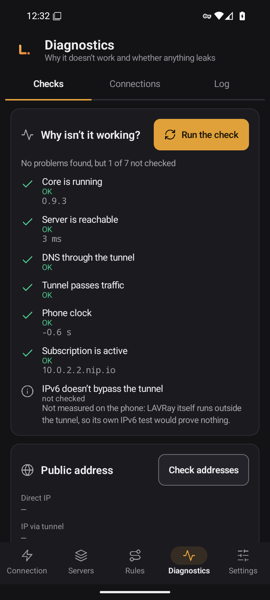
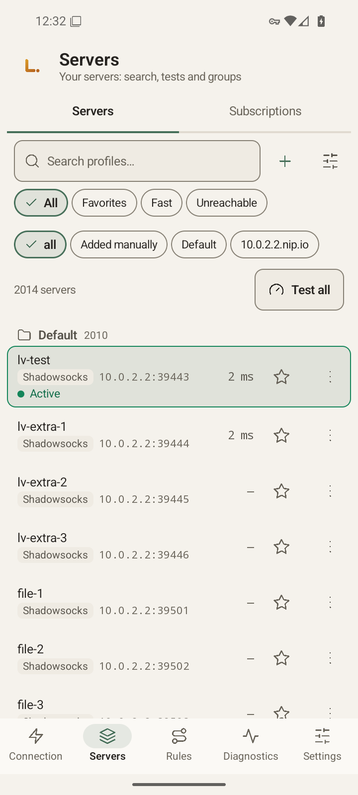
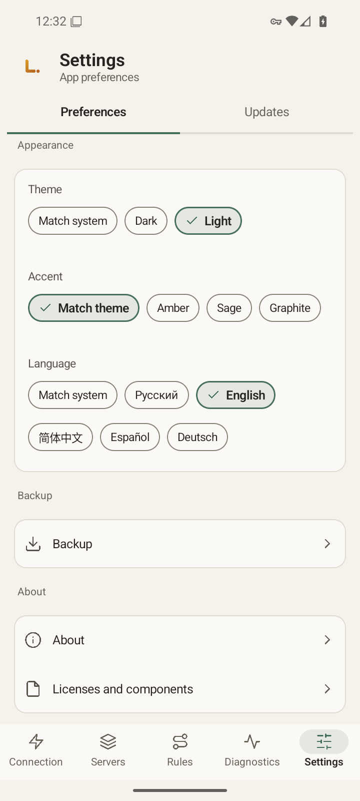

# LAVRay for Android

[Русский](README.md) · **English** · [中文](README.zh.md) · [Español](README.es.md) · [Deutsch](README.de.md)

*This is a translation of the Russian README. Release notes are in Russian.*

**LAVRay** for Android is a VPN client for your phone. It is a native Kotlin and Jetpack Compose app on top of the same Go core as [LAVRay for Windows](https://github.com/anatolijlaptev1991-ctrl/lavray-windows): the same names, the same route presets, the same screens and colors. It connects to your servers and subscriptions and, by default, sends the subscription provider no data about your device.

<p align="center">
  
  
  
</p>
<p align="center">
  
  
  
</p>

*Screenshots were taken on an emulator, with the English interface.*

> **Status: version 0.9.4. Checked on an Android 16 emulator (x86_64); the owner is testing it on a real phone.** This version follows a full audit: [docs/AUDIT-2026-11.md](docs/AUDIT-2026-11.md) (Russian). A checklist for testing on a phone is in [docs/PHONE-CHECKLIST.md](docs/PHONE-CHECKLIST.md) (Russian).

## Features

- **Servers and groups:** search, favorites, "Fast" and "Unreachable" filters, sorting, moving between groups, copies, a QR code for each server.
- **Subscriptions** with scheduled updates and a rollback to the last good state. A subscription link, including an encrypted one, creates the subscription on import and loads its servers at once; the message gives the real number of servers.
- **Import:** link, clipboard, QR code (camera or image), file. Links such as `vless://`, `vmess://`, `trojan://`, `ss://`, `hy2://`, `tuic://` can be opened in LAVRay from another app or sent with "Share". Nothing is imported until you confirm.
- **Honest connection state:** after connecting, the core checks whether traffic really passes through the server, and the screen shows the result. "Channel is protected" appears only when no problem was found.
- **Changes that need a restart** (route preset, DNS, MTU, the app list) are marked "applies after the restart", and the app offers to restart.
- **Latency test** for all servers and a URL test.
- **Route presets:** "Global", "Route everything through the proxy", "Route everything directly", **LAV Preset RU** (revision 3, active by default: Russian sites and games go direct, everything else goes through the proxy) and LAV Preset CN. Your own presets, import and export, and a "where does this address go" check.
- **DNS**, **connections**, **log**, **statistics**, and a "Why isn’t it working?" screen.
- **Per-app tunnel:** all apps, only selected apps, or all except selected.
- **Auto-connect after reboot** to the last server, and support for the system Always-on VPN. The tunnel is restored after an app update and after the system kills the service.
- **No direct traffic while the tunnel is rebuilt:** when you switch server or tap "Reconnect", apps’ traffic is held, not sent directly, for at most 30 seconds.
- **Backup** to an encrypted file through the system file picker.
- **Five interface languages** (Русский, English, 中文, Español, Deutsch), light and dark themes, several accents.

Protocols are the same as on the desktop: VLESS (including REALITY), VMess, Trojan, Shadowsocks, Hysteria2, TUIC, SOCKS, HTTP.

---

## Download

APKs are on the [Releases](https://github.com/anatolijlaptev1991-ctrl/lavray-android/releases) page; the latest release is [v0.9.4](https://github.com/anatolijlaptev1991-ctrl/lavray-android/releases/tag/v0.9.4). There is one file per CPU architecture:

| File | For | File size |
|---|---|---|
| `LAVRay-<version>-arm64-v8a.apk` | nearly all modern phones and tablets | 16.06 MB |
| `LAVRay-<version>-armeabi-v7a.apk` | old 32-bit devices | 16.53 MB |
| `LAVRay-<version>-x86_64.apk` | emulators and Chromebooks | 17.13 MB |
| `SHA256SUMS` | checksums | — |

If you are not sure, take `arm64-v8a`. Sizes are from [docs/MEASUREMENTS.md](docs/MEASUREMENTS.md) (Russian), section 10; the file size on the release page may differ by a fraction of a megabyte.

**Verify the file.** Download the APK and `SHA256SUMS` into the same folder:

```bash
sha256sum -c --ignore-missing SHA256SUMS      # Linux, macOS (on macOS: shasum -a 256 -c)
```

```powershell
Get-FileHash .\LAVRay-<version>-arm64-v8a.apk -Algorithm SHA256   # Windows: compare with the line in SHA256SUMS
```

**Signing.** Release APKs are signed with the owner's key, as described in [docs/SIGNING.md](docs/SIGNING.md) (Russian). An update installs over an existing copy only if it has the same signature.

Certificate `CN=LAVRay, O=LAVRay`, SHA-256 fingerprint: `fe058a98b9abb7ba8c853c0ae39c893aeeffa6892eb5a243e22718c2ac58fbb3`. Check it with `apksigner verify --print-certs <file>.apk`.

**Requirements:** Android 8.0 or newer (minSdk 26), an ARM (64-bit or 32-bit) or x86_64 processor.

---

## Quick start

1. **Install the APK.** Allow installs from your chosen source (browser, Files), open the file and confirm.
2. **Add a server.** "Connection" → "Add server", or "Servers" → the "+" icon. Paste a server or subscription link, scan a QR code with the camera, pick an image with a QR code, or pick a file. You see what will be added before it is imported.
3. **Connect.** "Connection" → "Connect". On Android 13 and newer you first get a notification permission prompt (the VPN runs as a foreground service with a notification), then the VPN consent dialog: accept both. Once connected, the screen shows the exit country and address, a leak check and the speed.
4. **Check the routes.** LAV Preset RU is already active: Russian sites open directly, everything else goes through the server. Pick another preset under "Rules".
5. **Auto-connect.** "Settings" → "Startup" → "Connect when the phone starts" (off by default). Details and limits are below.

---

## How to use

### Servers and subscriptions

- "Test all" measures latency. The view menu has a URL test: a real page is opened through each server. The current connection stays up during tests.
- Server menu: "Connect", favorite, "Copy link", "Share link", "Show QR code" (the link contains keys, and the app warns you), "Duplicate", "Move to group…", order, delete. Long-press to select several servers.
- Subscriptions: "Subscriptions" → add a link, then "Update". A failed update does not erase the old servers, and you can "Roll back".
- XHTTP links import but are marked "not supported by the core": you cannot connect through them.

### Rules and DNS

- Built-in presets are never changed: "Customize a copy" makes your own copy, and "Reset to original" restores it.
- "Check a route" shows where a domain or IP goes under the active preset.
- DNS: "Auto" (matches the active preset), local, DoH, DoT and through the tunnel, custom servers, FakeIP.

### Diagnostics

- **Checks** ("Why isn’t it working?"): core, server, tunnel, DNS, time, subscription.
- **Connections:** every connection with its address, outbound, rule and traffic, with search, pause and close.
- **Log:** "Copy" and "Share" give you the log with passwords, UUIDs, tokens and subscription addresses already hidden. You can attach it to a bug report.
- **Statistics:** traffic for the session and all time, by group and by route.

### Per-app tunnel

"Settings" → "Tunnel" → "Apps in the tunnel": all apps, only selected, or all except selected. LAVRay itself always stays outside the tunnel. A change applies after a reconnect: the app offers "Reconnect now".

### Settings

Language, theme and accent, "Check connectivity after connecting", IPv6 through the tunnel, MTU, address exclusions, mux, shortcuts to the system Always-on and battery settings, backup, "About" and licenses. The tunnel always runs on gVisor with MTU 9000 by default, and there is no stack choice in Settings.

### Updates

The "Updates" page only opens the releases page. The app does not contact the network for new versions and does not update itself: download a new APK and install it over the old one, and your data stays.

### Backup

"Settings" → "Backup": all data (servers with their passwords, groups, subscriptions, your presets, settings) in one `.lavbk` file under your password. Without the password the file cannot be opened. Restoring replaces all current data and requires you to disconnect from the VPN first.

---

## Auto-start, Always-on and phone differences

- Turn on "Connect when the phone starts": after a reboot the app connects to the last server. Android sends the boot signal only after the **first unlock** of the phone.
- If the phone booted with no network (for example, in airplane mode), the app waits quietly and connects when a network appears. There are no timers or polling.
- The most reliable way is the system **Always-on VPN**. In LAVRay: "Settings" → "System" → "Open VPN settings". This opens Android's VPN list: tap the gear next to LAVRay and turn on "Always-on VPN" and, if you want, "Block connections without VPN" (names vary by phone). LAVRay cannot see or change those switches. When the system starts the app, it treats it as an Always-on start and connects the last server.
- An app that was force-stopped does not get the boot signal until you open it again. A force-stop in Android settings turns the tunnel off and it does not come back by itself: this is intended.
- If the system kills the VPN service, it restarts and brings the tunnel back, and the app shows a banner with the reason. After an app update, a tunnel that was on comes back up.
- Manufacturer skins (Xiaomi/HyperOS, Huawei/HarmonyOS, Samsung, Oppo/Realme/OnePlus, Vivo) may block autostart or kill the service when the screen is off. Then add LAVRay to the autostart and battery manager exceptions. More in [docs/PHONE-CHECKLIST.md](docs/PHONE-CHECKLIST.md) (Russian).
- If another VPN app takes over the consent, LAVRay shows a "VPN permission needed" notification: open the app and confirm again.

---

## Measurements

All numbers come from [docs/MEASUREMENTS.md](docs/MEASUREMENTS.md) (Russian) Startup, memory and speed were measured **on an x86_64 Android 16 emulator (2 vCPU), not on a phone**; on a real device the numbers will differ. APK sizes are taken from the build files.

| Metric | Value (emulator) |
|---|---|
| APK size: arm64-v8a / armeabi-v7a / x86_64 | 16.06 / 16.53 / 17.13 MB (from build artifacts, not from the emulator; 0.9.3 was 20.65 / 21.24 / 21.97) |
| UI cold start, median | about 1.26 s (1259.5 ms, 16 runs) |
| `:vpn` process memory when idle (connected, screen off) | about 67 MB PSS |
| Wakelocks, alarms and jobs when idle | none |
| "Connect" tap to first reply through the tunnel, median | 844 ms (local test server) |
| MTU 9000 vs 1500, tunnel throughput | 4.1x faster down, 2.4x faster up (test bench inside the emulator, not a real network) |

The other rows were measured for 0.9.3 and not re-measured after the 0.9.4 changes. Not measured: battery drain, speed on a real phone, running on arm64 and armeabi-v7a.

---

## Privacy

Many subscription providers limit the number of devices by an identifier the client sends. **By default LAVRay sends no such identifier:** a subscription request carries only the User-Agent `LAVRay/<version>`. If your provider requires an HWID, turn on "Send a device identifier (HWID)" in the subscription settings: a random identifier created for this installation is sent, not data about your phone.

The camera is used only to read QR codes. The app reads the clipboard only when you open the import window. The app picker lists only apps that have a launcher icon. Android's own app backup is turned off for this app.

---

## Current limitations

- **No self-update:** new versions are installed by hand from the releases page.
- **Some desktop features are missing**, including a server editor, the "Full test" and the first-run wizard. The full list with reasons is in [docs/NOT-PORTED.md](docs/NOT-PORTED.md) (Russian).
- **XHTTP transport:** links import, but the core does not support it yet.
- **Tor is removed from the build:** it needs an external file that Android does not have. The tunnel always runs on gVisor, with no stack choice.
- **Only the system Always-on VPN with "Block connections without VPN" stays closed if the app dies.** Holding traffic inside the app lasts at most 30 seconds.
- **A subscription on a local-network address cannot be created:** the core does not accept such addresses.
- **Not tested on a real phone.**

---

## Build from source

You need JDK 21, the Android SDK (platform 36) with NDK 28.2.13676358, Go (the version in `third_party/lavray/core/go.mod`) and Bash.

```bash
git clone --recurse-submodules https://github.com/anatolijlaptev1991-ctrl/lavray-android.git
cd lavray-android
bash scripts/build-core.sh        # Go core -> app/libs/lavray-core.aar (gomobile bind)
./gradlew assembleRelease         # APKs in app/build/outputs/apk/release/
```

A local build is signed with the debug key and must not be distributed. Releases are built by `release.yml` on a `v*` tag; the key is described in [docs/SIGNING.md](docs/SIGNING.md). Code layout: [docs/ARCHITECTURE.md](docs/ARCHITECTURE.md), stack choice: [docs/STACK.md](docs/STACK.md) (both in Russian).

## Report a bug

[Create an issue](../../issues/new/choose): what you did, what you expected, what happened, phone model, Android version, manufacturer skin, LAVRay version ("Settings" → "About") and the log ("Diagnostics" → "Log" → "Share").

## Source code and license

The app code (Kotlin, Compose) and the core build are in this repository. The Go core and the desktop interface are in [lavray](https://github.com/anatolijlaptev1991-ctrl/lavray), included as the `third_party/lavray` submodule (tag v0.9.3).

License: [GPL-3.0-only](LICENSE). LAVRay is based on nekoray/NekoBox (GPL-3.0) and sing-box (GPL-3.0 or later).
