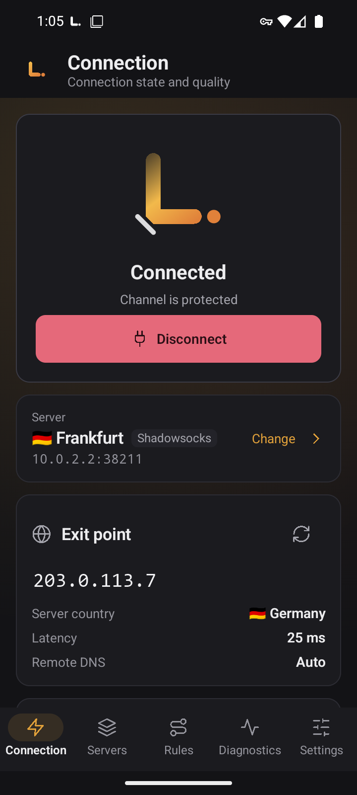
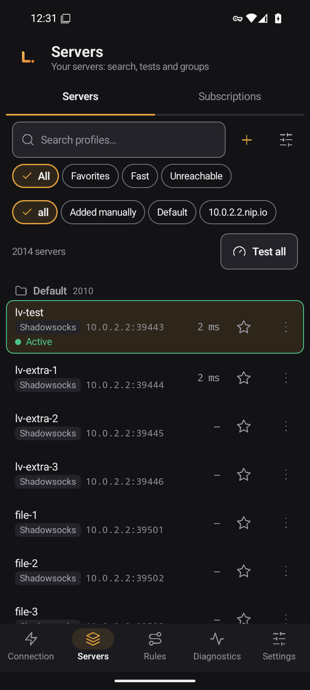
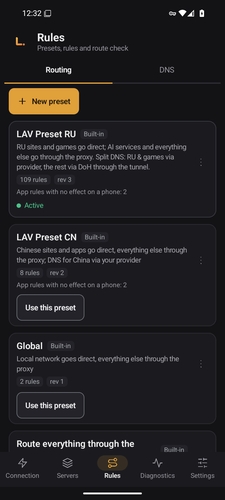
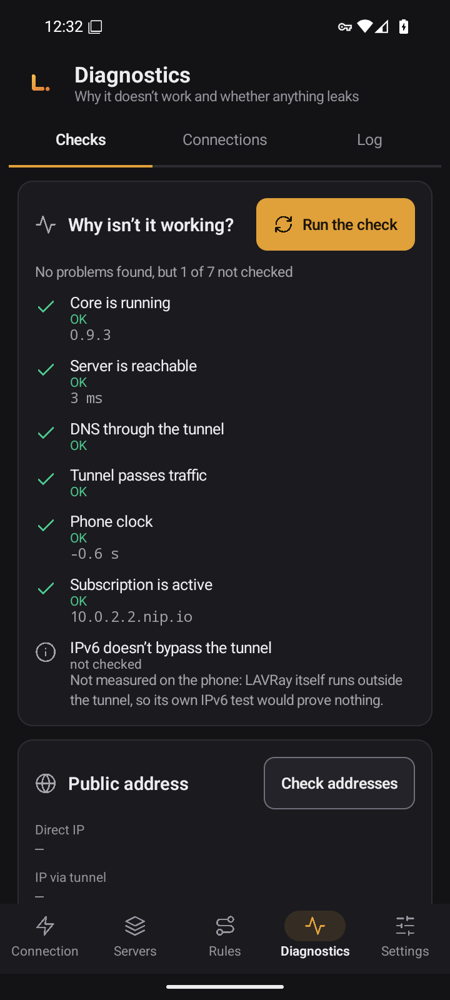
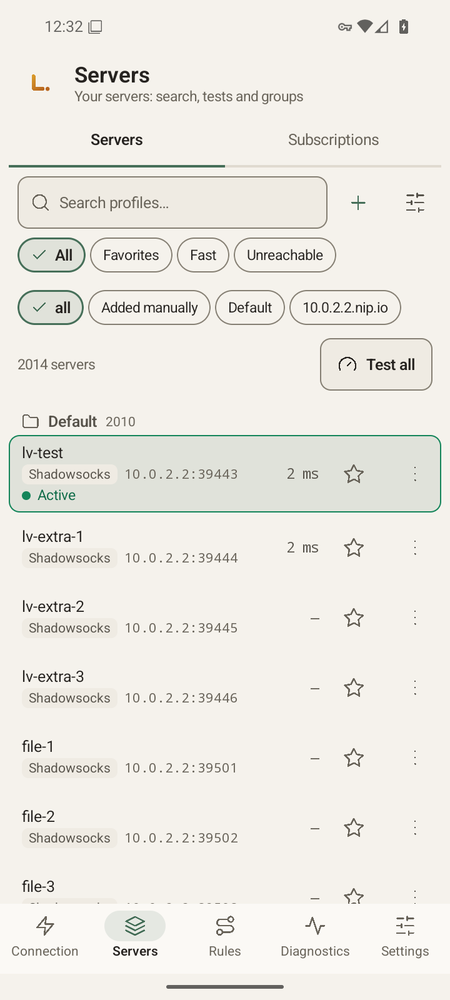
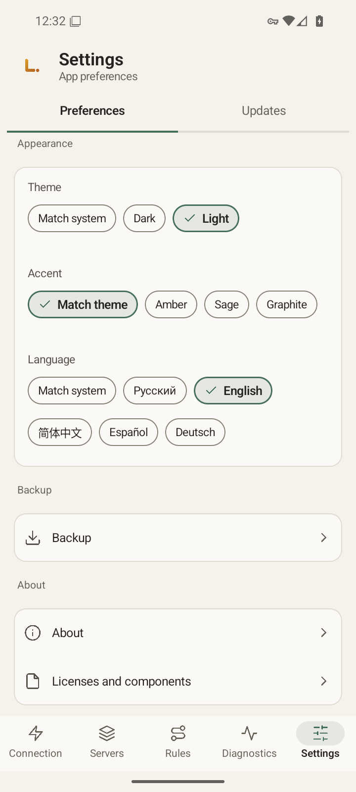

# LAVRay para Android

[Русский](README.md) · [English](README.en.md) · [中文](README.zh.md) · **Español** · [Deutsch](README.de.md)

*Traducción del README en ruso. Las notas de la versión están en ruso.*

**LAVRay** para Android es un cliente VPN para el móvil. Es una app nativa en Kotlin y Jetpack Compose sobre el mismo núcleo en Go que [LAVRay para Windows](https://github.com/anatolijlaptev1991-ctrl/lavray-windows): mismos nombres, mismos conjuntos de rutas, mismas pantallas y mismos colores. Se conecta a tus servidores y suscripciones y, por defecto, no envía al proveedor de la suscripción ningún dato de tu dispositivo.

<p align="center">
  
  
  
</p>
<p align="center">
  
  
  
</p>

*Las capturas son de un emulador, con la interfaz en inglés.*

> **Estado: versión 0.9.4. Comprobada en un emulador de Android 16 (x86_64); el propietario la está probando en un móvil real.** Esta versión llega tras una auditoría completa: [docs/AUDIT-2026-11.md](docs/AUDIT-2026-11.md) (en ruso). La lista de comprobación para probarla en un móvil está en [docs/PHONE-CHECKLIST.md](docs/PHONE-CHECKLIST.md) (en ruso).

## Qué ofrece

- **Servidores y grupos:** búsqueda, favoritos, filtros «Rápidos» e «Inaccesibles», orden, mover entre grupos, copias y código QR de cada servidor.
- **Suscripciones** con actualización programada y reversión al último estado correcto. Un enlace de suscripción, también cifrado, crea la suscripción al importar y carga sus servidores de inmediato; el mensaje indica el número real de servidores.
- **Importación:** enlace, portapapeles, código QR (cámara o imagen) y archivo. Los enlaces `vless://`, `vmess://`, `trojan://`, `ss://`, `hy2://`, `tuic://` y otros se pueden abrir en LAVRay desde otra app o enviar con «Compartir». No se importa nada hasta que lo confirmes.
- **Estado de la conexión sin adornos:** tras conectar, el núcleo comprueba si el tráfico pasa de verdad por el servidor y la pantalla muestra el resultado. «Canal protegido» solo aparece si no se encontró ningún problema.
- **Los cambios que necesitan reinicio** (conjunto de rutas, DNS, MTU, lista de apps) se marcan como «se aplica tras reiniciar» y la app ofrece reiniciar.
- **Prueba de latencia** de todos los servidores y prueba de URL.
- **Conjuntos de rutas:** «Global», «Todo por el proxy», «Todo directo», **LAV Preset RU** (revisión 3, activo por defecto: los sitios y juegos rusos van directos y el resto por el proxy) y LAV Preset CN. Conjuntos propios, importación y exportación, y una comprobación de «a dónde va esta dirección».
- **DNS**, **conexiones**, **registro**, **estadísticas** y una pantalla «¿Por qué no funciona?».
- **Túnel por app:** todas, solo las elegidas o todas menos las elegidas.
- **Conexión automática tras reiniciar** al último servidor y compatibilidad con la VPN siempre activa del sistema. El túnel se restablece tras actualizar la app y tras un cierre del servicio por parte del sistema.
- **Sin tráfico directo mientras se reconstruye el túnel:** al cambiar de servidor o pulsar «Reconectar», el tráfico de las apps se retiene, no sale directo, como máximo 30 segundos.
- **Copia de seguridad** en un archivo cifrado, mediante el selector de archivos del sistema.
- **Cinco idiomas** de interfaz (Русский, English, 中文, Español, Deutsch), temas claro y oscuro y varios colores de acento.

Los protocolos son los mismos que en la versión de escritorio: VLESS (incluido REALITY), VMess, Trojan, Shadowsocks, Hysteria2, TUIC, SOCKS, HTTP.

---

## Descargar

Los APK están en la página de [Releases](https://github.com/anatolijlaptev1991-ctrl/lavray-android/releases); la última versión es [v0.9.4](https://github.com/anatolijlaptev1991-ctrl/lavray-android/releases/tag/v0.9.4). Hay un archivo por arquitectura de CPU:

| Archivo | Para | Tamaño |
|---|---|---|
| `LAVRay-<versión>-arm64-v8a.apk` | casi todos los móviles y tabletas actuales | 16,06 MB |
| `LAVRay-<versión>-armeabi-v7a.apk` | dispositivos antiguos de 32 bits | 16,53 MB |
| `LAVRay-<versión>-x86_64.apk` | emuladores y Chromebooks | 17,13 MB |
| `SHA256SUMS` | sumas de verificación | — |

Si dudas, elige `arm64-v8a`. Los tamaños proceden de [docs/MEASUREMENTS.md](docs/MEASUREMENTS.md) (en ruso).

**Comprobar el archivo.** Descarga el APK y `SHA256SUMS` en la misma carpeta:

```bash
sha256sum -c --ignore-missing SHA256SUMS      # Linux, macOS (en macOS: shasum -a 256 -c)
```

```powershell
Get-FileHash .\LAVRay-<versión>-arm64-v8a.apk -Algorithm SHA256   # Windows: compara con la línea de SHA256SUMS
```

**Firma.** Los APK de las versiones se firman con la clave del propietario, como se describe en [docs/SIGNING.md](docs/SIGNING.md) (en ruso). Una actualización solo se instala sobre la app existente si tiene la misma firma.

Certificado `CN=LAVRay, O=LAVRay`, huella SHA-256: `fe058a98b9abb7ba8c853c0ae39c893aeeffa6892eb5a243e22718c2ac58fbb3`. Compruébala con `apksigner verify --print-certs <archivo>.apk`.

**Requisitos:** Android 8.0 o superior (minSdk 26), procesador ARM (64 o 32 bits) o x86_64.

---

## Inicio rápido

1. **Instala el APK.** Permite instalar desde el origen que uses (navegador, Archivos), abre el archivo y confirma.
2. **Añade un servidor.** «Conexión» → «Añadir servidor», o «Servidores» → el icono «+». Pega un enlace de servidor o de suscripción, escanea un código QR con la cámara, elige una imagen con un código QR o elige un archivo. Antes de importar ves lo que se va a añadir.
3. **Conecta.** «Conexión» → «Conectar». En Android 13 y posteriores aparece primero la petición de permiso de notificaciones (la VPN funciona como servicio en primer plano con una notificación) y después el diálogo de consentimiento de VPN: acepta ambos. Al conectar, la pantalla muestra el país y la dirección de salida, la comprobación de fugas y la velocidad.
4. **Revisa las rutas.** LAV Preset RU ya está activo: los sitios rusos se abren directos y el resto pasa por el servidor. Otro conjunto se elige en «Reglas».
5. **Conexión automática.** «Ajustes» → «Inicio» → «Conectar al iniciar el teléfono» (desactivado por defecto). Los detalles y límites están más abajo.

---

## Cómo usarlo

### Servidores y suscripciones

- «Probar todos» mide la latencia. El menú de vista incluye «Prueba de URL»: se abre una página real a través de cada servidor. La conexión actual no se corta durante las pruebas.
- Menú del servidor: «Conectar», favorito, «Copiar enlace», «Compartir enlace», «Mostrar código QR» (el enlace contiene claves y la app te avisa), «Duplicar», «Mover a grupo…», orden y borrar. Una pulsación larga selecciona varios servidores.
- Suscripciones: «Suscripciones» → añade un enlace y pulsa «Actualizar». Una actualización fallida no borra los servidores anteriores, y puedes «Revertir».
- Los enlaces XHTTP se importan, pero aparecen como «no compatible con el núcleo»: no se puede conectar a través de ellos.

### Reglas y DNS

- Los conjuntos integrados no se modifican: «Personalizar una copia» crea tu propia copia y «Restablecer al original» la deja como estaba.
- «Comprobar una ruta» muestra a dónde va un dominio o una IP con el conjunto activo.
- DNS: «Auto» (según el conjunto activo), local, DoH, DoT y a través del túnel, servidores propios y FakeIP.

### Diagnóstico

- **Comprobaciones** («¿Por qué no funciona?»): núcleo, servidor, túnel, DNS, hora y suscripción.
- **Conexiones:** cada conexión con su dirección, salida, regla y tráfico, con búsqueda, pausa y cierre.
- **Registro:** «Copiar» y «Compartir» entregan el registro con contraseñas, UUID, tokens y direcciones de suscripción ya ocultos. Puedes adjuntarlo a un informe de error.
- **Estadísticas:** tráfico de la sesión y total, por grupo y por ruta.

### Túnel por app

«Ajustes» → «Túnel» → «Apps en el túnel»: todas las apps, solo las elegidas o todas menos las elegidas. LAVRay siempre queda fuera del túnel. El cambio se aplica tras reconectar: la app ofrece «Reconectar ahora».

### Ajustes

Idioma, tema y acento, «Comprobar la conexión tras conectar», IPv6 por el túnel, MTU, exclusión de direcciones, mux, accesos a los ajustes del sistema de VPN siempre activa y de batería, copia de seguridad, «Acerca de LAVRay» y licencias. El túnel siempre usa gVisor con MTU 9000 por defecto, y en los ajustes no se puede elegir la pila.

### Actualizaciones

La página «Actualizaciones» solo abre la página de versiones. La app no consulta la red en busca de versiones nuevas ni se actualiza sola: descarga un APK nuevo e instálalo sobre el anterior, y tus datos se conservan.

### Copia de seguridad

«Ajustes» → «Copia de seguridad»: todos los datos (servidores con sus contraseñas, grupos, suscripciones, conjuntos propios y ajustes) en un archivo `.lavbk` protegido con tu contraseña. Sin la contraseña no se puede abrir. Restaurar reemplaza todos los datos actuales y exige desconectar la VPN antes.

---

## Inicio automático, VPN siempre activa y diferencias entre móviles

- Activa «Conectar al iniciar el teléfono»: tras reiniciar, la app se conecta al último servidor. Android envía la señal de arranque solo después del **primer desbloqueo** del móvil.
- Si el móvil arrancó sin red (por ejemplo, en modo avión), la app espera en silencio y conecta cuando aparece una red. No hay temporizadores ni sondeos.
- La forma más fiable es la **VPN siempre activa** del sistema. En LAVRay: «Ajustes» → «Sistema» → «Abrir ajustes de VPN». Se abre la lista de VPN de Android: toca el engranaje junto a LAVRay y activa «VPN siempre activa» y, si quieres, «Bloquear conexiones sin VPN» (los nombres dependen del móvil). LAVRay no ve ni puede cambiar esos interruptores. Si el sistema inicia la app, la trata como un inicio de VPN siempre activa y conecta el último servidor.
- Una app detenida a la fuerza no recibe la señal de arranque hasta que la abras de nuevo. Detener a la fuerza en los ajustes de Android apaga el túnel y este no vuelve solo: es intencionado.
- Si el sistema cierra el servicio VPN, este se reinicia y recupera el túnel, y la app muestra un aviso con el motivo. Tras actualizar la app, un túnel que estaba activo vuelve a levantarse.
- Las capas de los fabricantes (Xiaomi/HyperOS, Huawei/HarmonyOS, Samsung, Oppo/Realme/OnePlus, Vivo) pueden bloquear el inicio automático o cerrar el servicio con la pantalla apagada. En ese caso añade LAVRay a las excepciones del gestor de inicio automático y de batería. Más detalles en [docs/PHONE-CHECKLIST.md](docs/PHONE-CHECKLIST.md) (en ruso).
- Si otra app de VPN te quita el consentimiento, LAVRay muestra la notificación «Se necesita permiso de VPN»: abre la app y confirma de nuevo.

---

## Mediciones

Todas las cifras proceden de [docs/MEASUREMENTS.md](docs/MEASUREMENTS.md) (en ruso) El arranque, la memoria y la velocidad se midieron **en un emulador x86_64 con Android 16 (2 vCPU), no en un móvil**; en un dispositivo real serán distintos. Los tamaños de los APK salen de los archivos de la compilación.

| Medida | Valor (emulador) |
|---|---|
| Tamaño del APK: arm64-v8a / armeabi-v7a / x86_64 | 16,06 / 16,53 / 17,13 MB (de los artefactos de compilación, no del emulador; en 0.9.3 eran 20,65 / 21,24 / 21,97) |
| Arranque en frío de la interfaz, mediana | unos 1,26 s (1259,5 ms, 16 arranques) |
| Memoria del proceso `:vpn` en reposo (conectado, pantalla apagada) | unos 67 MB de PSS |
| Wakelocks, alarmas y tareas en reposo | ninguno |
| De pulsar «Conectar» a la primera respuesta por el túnel, mediana | 844 ms (servidor de prueba local) |
| MTU 9000 frente a 1500, caudal por el túnel | 4,1 veces más rápido de bajada y 2,4 de subida (banco de pruebas dentro del emulador, no una red real) |

Las demás filas se midieron para 0.9.3 y no se repitieron tras los cambios de 0.9.4. No medido: consumo de batería, velocidad en un móvil real, ejecución en arm64 y armeabi-v7a.

---

## Privacidad

Muchos proveedores de suscripciones limitan el número de dispositivos con un identificador que envía el cliente. **Por defecto, LAVRay no envía ningún identificador así:** la petición de la suscripción lleva solo el User-Agent `LAVRay/<versión>`. Si tu proveedor exige un HWID, activa «Enviar identificador de dispositivo (HWID)» en los ajustes de la suscripción: se envía un identificador aleatorio creado para esta instalación, no datos de tu móvil.

La cámara solo sirve para leer códigos QR. La app lee el portapapeles únicamente cuando abres la ventana de importación. El selector de apps solo lista las que tienen icono de lanzador. La copia de seguridad propia de Android está desactivada para esta app.

---

## Qué todavía no hace

- **Sin actualización automática:** las versiones nuevas se instalan a mano desde la página de versiones.
- **Faltan algunas funciones de la versión de escritorio**, entre ellas el editor de servidores, la «Prueba completa» y el asistente de primer inicio. La lista completa con los motivos está en [docs/NOT-PORTED.md](docs/NOT-PORTED.md) (en ruso).
- **Transporte XHTTP:** los enlaces se importan, pero el núcleo todavía no lo admite.
- **Tor se ha quitado de la compilación:** necesita un archivo externo que Android no tiene. El túnel siempre usa gVisor, sin elegir pila.
- **Solo la VPN siempre activa del sistema con «Bloquear conexiones sin VPN» sigue cerrada si la app muere.** La retención del tráfico dentro de la app dura como máximo 30 segundos.
- **No se puede crear una suscripción con una dirección de red local:** el núcleo no acepta esas direcciones.
- **Sin probar en un móvil real.**

---

## Compilar desde el código fuente

Necesitas JDK 21, el SDK de Android (plataforma 36) con NDK 28.2.13676358, Go (la versión de `third_party/lavray/core/go.mod`) y Bash.

```bash
git clone --recurse-submodules https://github.com/anatolijlaptev1991-ctrl/lavray-android.git
cd lavray-android
bash scripts/build-core.sh        # núcleo Go -> app/libs/lavray-core.aar (gomobile bind)
./gradlew assembleRelease         # APK en app/build/outputs/apk/release/
```

Una compilación local se firma con la clave de depuración y no debe distribuirse. Las versiones las compila `release.yml` al crear una etiqueta `v*`; la clave se describe en [docs/SIGNING.md](docs/SIGNING.md). Estructura del código: [docs/ARCHITECTURE.md](docs/ARCHITECTURE.md); elección de tecnologías: [docs/STACK.md](docs/STACK.md) (ambos en ruso).

## Informar de un error

[Crea un issue](../../issues/new/choose): qué hacías, qué esperabas, qué pasó, modelo del móvil, versión de Android, capa del fabricante, versión de LAVRay («Ajustes» → «Acerca de LAVRay») y el registro («Diagnóstico» → «Registro» → «Compartir»).

## Código fuente y licencia

El código de la app (Kotlin, Compose) y la compilación del núcleo están en este repositorio. El núcleo en Go y la interfaz de escritorio están en [lavray](https://github.com/anatolijlaptev1991-ctrl/lavray), incluidos como submódulo `third_party/lavray` (etiqueta v0.9.3).

Licencia [GPL-3.0-only](LICENSE). LAVRay se basa en nekoray/NekoBox (GPL-3.0) y sing-box (GPL-3.0 o posterior).
