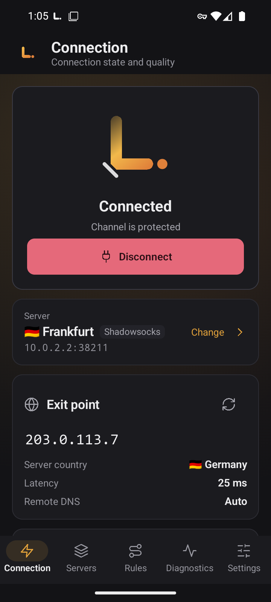
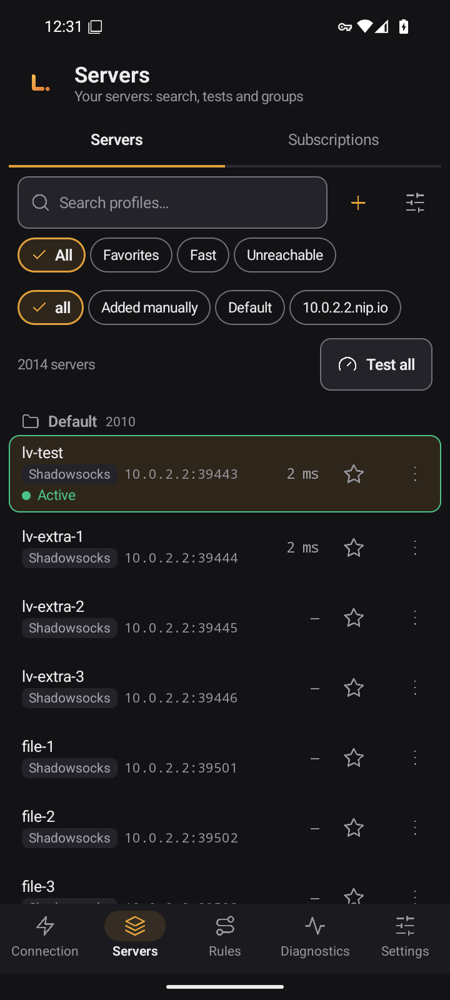
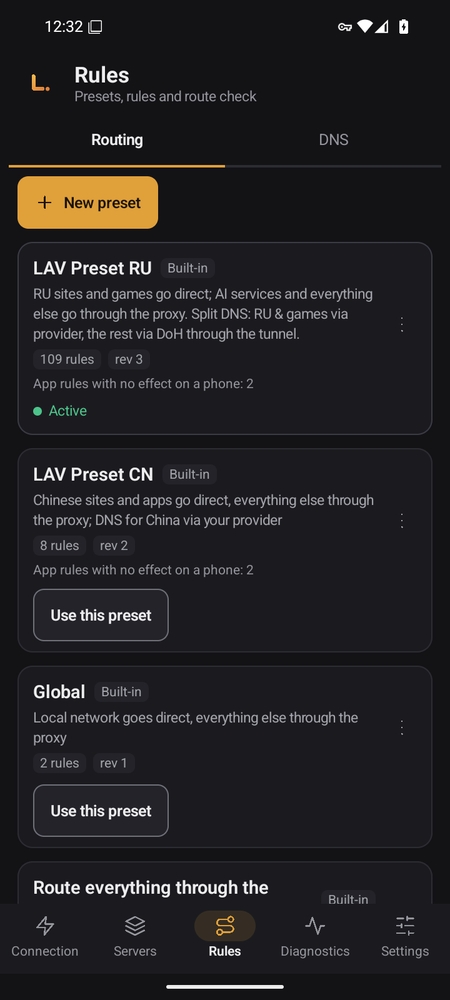
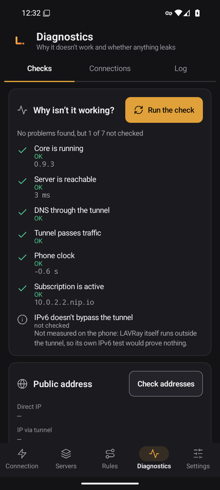
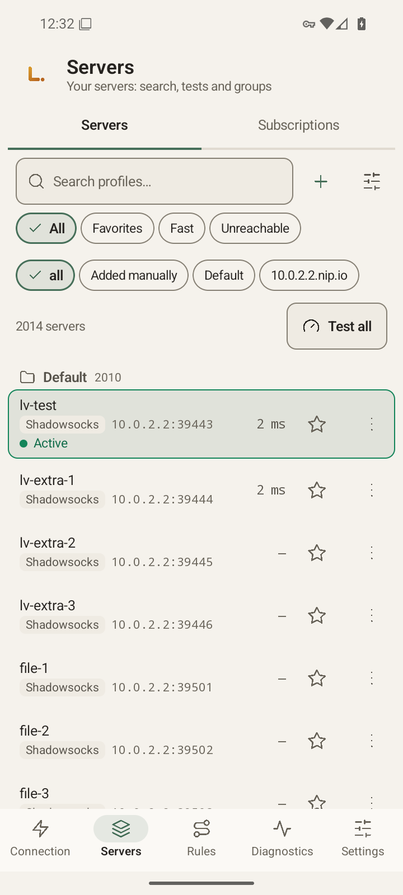
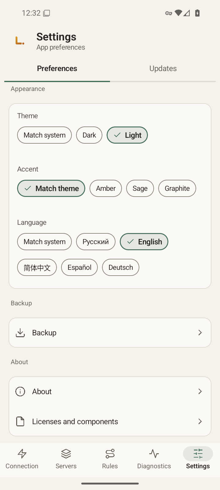

# LAVRay для Android

**Русский** · [English](README.en.md) · [中文](README.zh.md) · [Español](README.es.md) · [Deutsch](README.de.md)

**LAVRay** для Android — VPN-клиент для телефона. Это нативное приложение на Kotlin и Jetpack Compose поверх того же ядра на Go, что и в [LAVRay для Windows](https://github.com/anatolijlaptev1991-ctrl/lavray-windows): те же названия, те же наборы маршрутов, те же экраны и цвета. Он подключается к вашим серверам и подпискам и по умолчанию не передаёт провайдеру подписки никаких данных об устройстве.

<p align="center">
  
  
  
</p>
<p align="center">
  
  
  
</p>

*Снимки сделаны на эмуляторе, интерфейс на английском.*

> **Статус: версия 0.9.4. Проверена на эмуляторе Android 16 (x86_64), на реальном телефоне её проверяет владелец.** Версия 0.9.4 вышла после полного аудита: [docs/AUDIT-2026-11.md](docs/AUDIT-2026-11.md). Чек-лист для проверки на телефоне — [docs/PHONE-CHECKLIST.md](docs/PHONE-CHECKLIST.md).

## Возможности

- **Серверы и группы:** поиск, избранное, фильтры «Быстрые» и «Недоступные», сортировка, перенос между группами, копии, QR-код сервера.
- **Подписки** с обновлением по расписанию и откатом к последнему удачному состоянию. Ссылка подписки, в том числе зашифрованная, при импорте создаёт подписку и сразу загружает серверы; сообщение называет настоящее число серверов.
- **Импорт:** ссылка, буфер обмена, QR-код (камера или картинка), файл. Ссылки `vless://`, `vmess://`, `trojan://`, `ss://`, `hy2://`, `tuic://` и другие можно открыть в LAVRay из другого приложения или отправить через «Поделиться»: до подтверждения ничего не импортируется.
- **Честное состояние подключения:** после подключения ядро проверяет, идёт ли трафик через сервер, и экран показывает результат. «Канал защищён» пишется только когда проблем не найдено.
- **Изменения, которые нужно применить перезапуском** (набор маршрутов, DNS, MTU, список приложений), экран помечает «применится после перезапуска» и предлагает перезапустить.
- **Проверка задержки** всех серверов и URL-тест.
- **Наборы маршрутов:** «Глобальный», «Всё через прокси», «Всё напрямую», **LAV Preset RU** (ревизия 3, включён по умолчанию: российские сайты и игры напрямую, остальное через прокси) и LAV Preset CN. Свои наборы, импорт и экспорт, проверка «куда пойдёт адрес».
- **DNS**, **соединения**, **журнал**, **статистика**, экран «Почему не работает?».
- **Приложения в туннеле:** все, только выбранные или все, кроме выбранных.
- **Автоподключение после перезагрузки** к последнему серверу и поддержка системного Always-on VPN. Туннель возвращается после обновления приложения и после того, как система убила службу.
- **Без прямого трафика при смене сервера:** при смене сервера, «Переподключить» и перезапуске ядра интерфейс VPN остаётся тем же, а трафик приложений не уходит напрямую, а удерживается не дольше 30 секунд. Исключение: если меняются параметры самого интерфейса (MTU, IPv6, DNS туннеля, список приложений), Android создаёт новый интерфейс, и на доли секунды окно возможно.
- **Резервная копия** в зашифрованный файл через системный выбор файла.
- **Пять языков** интерфейса (русский, English, 中文, Español, Deutsch), светлая и тёмная темы, несколько акцентов.

Протоколы те же, что у настольной версии: VLESS (в том числе REALITY), VMess, Trojan, Shadowsocks, Hysteria2, TUIC, SOCKS, HTTP.

---

## Скачать

APK лежат на странице [Releases](https://github.com/anatolijlaptev1991-ctrl/lavray-android/releases), последний выпуск: [v0.9.4](https://github.com/anatolijlaptev1991-ctrl/lavray-android/releases/tag/v0.9.4). Для каждой архитектуры свой файл:

| Файл | Для чего | Размер файла |
|---|---|---|
| `LAVRay-<версия>-arm64-v8a.apk` | почти все современные телефоны и планшеты | 16,06 МБ |
| `LAVRay-<версия>-armeabi-v7a.apk` | старые 32-битные устройства | 16,53 МБ |
| `LAVRay-<версия>-x86_64.apk` | эмуляторы и Chromebook | 17,13 МБ |
| `SHA256SUMS` | контрольные суммы | — |

Не знаете, какой выбрать, берите `arm64-v8a`. Размеры взяты из [docs/MEASUREMENTS.md](docs/MEASUREMENTS.md), раздел 10; размер файла на странице выпуска может отличаться на доли мегабайта.

**Проверка файла.** Скачайте APK и `SHA256SUMS` в одну папку:

```bash
sha256sum -c --ignore-missing SHA256SUMS      # Linux, macOS (на macOS: shasum -a 256 -c)
```

```powershell
Get-FileHash .\LAVRay-<версия>-arm64-v8a.apk -Algorithm SHA256   # Windows, сверьте со строкой в SHA256SUMS
```

**Подпись.** Релизные APK подписывает ключ владельца, как описано в [docs/SIGNING.md](docs/SIGNING.md). Обновление ставится поверх только APK с той же подписью.

Сертификат `CN=LAVRay, O=LAVRay`, отпечаток SHA-256: `fe058a98b9abb7ba8c853c0ae39c893aeeffa6892eb5a243e22718c2ac58fbb3`. Сверка: `apksigner verify --print-certs <файл>.apk`.

**Требования:** Android 8.0 или новее (minSdk 26), 64-битный или 32-битный процессор ARM либо x86_64.

---

## Быстрый старт

1. **Установите APK.** Разрешите установку из выбранного источника (браузер, «Файлы»), откройте файл и подтвердите установку.
2. **Добавьте сервер.** Экран «Подключение» → «Добавить сервер», или «Серверы» → значок «+». Вставьте ссылку сервера или подписки, отсканируйте QR-код камерой, выберите картинку с QR-кодом или файл. Перед импортом видно, что будет добавлено.
3. **Подключитесь.** «Подключение» → «Подключиться». На Android 13 и новее сначала появится запрос разрешения на уведомления (VPN работает как служба переднего плана с уведомлением), затем окно согласия на VPN: подтвердите оба. После подключения на экране видны страна и адрес выхода, проверка утечек и скорость.
4. **Проверьте маршруты.** Набор LAV Preset RU уже активен: российские сайты открываются напрямую, остальное идёт через сервер. Другой набор выбирается в «Правила».
5. **Автоподключение.** «Настройки» → «Запуск» → «Подключаться при запуске телефона» (по умолчанию выключено). Подробности и ограничения — ниже.

---

## Как пользоваться

### Серверы и подписки

- «Проверить все» меряет задержку, меню вида содержит URL-тест: через сервер открывается настоящая страница. Во время теста подключение не прерывается.
- Меню сервера: «Подключиться», избранное, «Копировать ссылку», «Поделиться ссылкой», «Показать QR-код» (ссылка содержит ключи, приложение предупреждает), «Дублировать», «Переместить в группу…», порядок, удаление. Несколько серверов выбираются долгим нажатием.
- Подписки: «Подписки» → добавить ссылку, затем «Обновить». Неудачное обновление не стирает старые серверы, его можно «Откатить».
- Ссылки XHTTP импортируются, но помечены «не поддерживается ядром»: подключиться через них нельзя.

### Правила и DNS

- Встроенные наборы не меняются: «Настроить копию» создаёт свою копию, «Сбросить к исходному» возвращает её.
- «Проверить маршрут» показывает, куда пойдёт домен или IP по активному набору.
- DNS: режимы «Авто» (под активный набор), локальный, DoH, DoT и через туннель, свои серверы, FakeIP.

### Диагностика

- **Проверки** («Почему не работает?»): ядро, сервер, туннель, DNS, время, подписка.
- **Соединения:** каждое соединение с адресом, исходящим, правилом и объёмом, поиск, пауза, закрытие.
- **Журнал:** «Копировать» и «Поделиться» отдают журнал с уже скрытыми паролями, UUID, токенами и адресами подписок. Его можно прикладывать к сообщению об ошибке.
- **Статистика:** трафик за сессию, за всё время, по группам и маршрутам.

### Приложения в туннеле

«Настройки» → «Туннель» → «Приложения в туннеле»: все приложения, только выбранные или все, кроме выбранных. Сам LAVRay всегда остаётся вне туннеля. Изменение действует после переподключения: приложение предлагает «Переподключить сейчас».

### Настройки

Язык, тема и акцент, «Проверять связь после подключения», IPv6 через туннель, MTU, исключения по адресам, mux, переход в системные настройки Always-on и батареи, резервная копия, «О программе» и лицензии. Туннель всегда работает на gVisor с MTU 9000 по умолчанию, выбора стека в настройках нет.

### Обновления

Раздел «Обновления» только открывает страницу выпусков. Приложение не обращается в сеть за новыми версиями и не обновляется само: скачайте новый APK и поставьте поверх, данные сохранятся.

### Резервная копия

«Настройки» → «Резервная копия»: все данные (серверы с паролями, группы, подписки, свои наборы, настройки) в один файл `.lavbk` под вашим паролем. Без пароля копию не открыть. Восстановление заменяет все текущие данные и требует отключиться от VPN.

---

## Автозапуск, Always-on и особенности телефонов

- Включите «Подключаться при запуске телефона»: после перезагрузки приложение подключится к последнему серверу. Android присылает сигнал загрузки только после **первой разблокировки** телефона.
- Если телефон загрузился без сети (например, в режиме полёта), приложение молча ждёт и подключается, когда сеть появится. Таймеров и опроса нет.
- Самый надёжный способ — системный **Always-on VPN**. В LAVRay: «Настройки» → «Система» → «Открыть настройки VPN»; откроется список VPN в Android, там нажмите шестерёнку рядом с LAVRay и включите «Постоянная VPN» и при желании «Блокировать подключения без VPN» (названия зависят от оболочки). LAVRay эти переключатели не видит и не меняет. Запуск системой приложение считает запуском Always-on и подключает последний сервер.
- Приложение, остановленное принудительно, не получает сигнал загрузки, пока вы не откроете его. Принудительная остановка в настройках Android отключает туннель, и он не возвращается сам: так сделано намеренно.
- Если систему убила службу VPN, она перезапускается и поднимает туннель, а в приложении виден баннер с причиной. После обновления приложения туннель, который был включён, поднимается снова.
- Оболочки производителей (Xiaomi/HyperOS, Huawei/HarmonyOS, Samsung, Oppo/Realme/OnePlus, Vivo) могут запретить автозапуск или убить службу при выключенном экране. Тогда добавьте LAVRay в исключения менеджера автозапуска и батареи. Подробности — в [docs/PHONE-CHECKLIST.md](docs/PHONE-CHECKLIST.md).
- Если другое VPN-приложение отняло согласие, LAVRay покажет уведомление «Нужно разрешение VPN»: откройте приложение и подтвердите заново.

---

## Замеры

Все числа из [docs/MEASUREMENTS.md](docs/MEASUREMENTS.md). Запуск, память и скорость измерены **на эмуляторе x86_64 с Android 16 (2 vCPU), а не на телефоне**; на реальном устройстве числа будут другими. Размеры APK взяты из файлов сборки.

| Показатель | Значение (эмулятор) |
|---|---|
| Размер APK: arm64-v8a / armeabi-v7a / x86_64 | 16,06 / 16,53 / 17,13 МБ (по артефактам сборки, не на эмуляторе; в 0.9.3 было 20,65 / 21,24 / 21,97) |
| Холодный старт интерфейса, медиана | около 1,26 с (1259,5 мс, 16 запусков) |
| Память процесса `:vpn` в простое (подключено, экран выключен) | около 67 МБ PSS |
| Wakelock, будильники и задания в простое | нет ни одного |
| «Подключить» до первого ответа через туннель, медиана | 844 мс (локальный тестовый сервер) |
| MTU 9000 против 1500, скорость через туннель | вниз в 4,1 раза, вверх в 2,4 раза больше (стенд внутри эмулятора, не реальная сеть) |

Остальные строки таблицы измерены для 0.9.3 и после правок 0.9.4 не перемерялись. Не измерено: расход батареи, скорость на реальном телефоне, запуск на arm64 и armeabi-v7a.

---

## Приватность

Многие провайдеры подписок ограничивают число устройств по идентификатору, который присылает клиент. **LAVRay по умолчанию такого идентификатора не отправляет:** в запросе подписки только User-Agent `LAVRay/<версия>`. Если провайдер требует HWID, включите «Передавать идентификатор устройства» в настройках подписки: отправится случайный идентификатор этой установки, не данные телефона.

Камера нужна только для чтения QR-кодов. Буфер обмена приложение читает только когда вы открыли окно импорта. Список приложений для выбора строится только из тех, у кого есть значок запуска. Резервное копирование Android для приложения выключено.

---

## Что пока не умеет

- **Нет самообновления:** новые версии ставятся вручную со страницы выпусков.
- **Нет некоторых функций настольной версии**, в том числе редактора сервера, «Полного теста» и мастера первого запуска. Полный список с причинами — [docs/NOT-PORTED.md](docs/NOT-PORTED.md).
- **Транспорт XHTTP:** ссылки импортируются, ядро его пока не поддерживает.
- **Tor убран из сборки:** ему нужен внешний файл, на Android его нет. Туннель всегда работает на gVisor, выбора стека нет.
- **Закрытым при гибели приложения остаётся только системный Always-on с блокировкой соединений без VPN.** Удержание трафика в самом приложении длится не дольше 30 секунд.
- **Подписку по адресу из локальной сети создать нельзя:** ядро такие адреса не принимает.
- **Не проверено на реальном телефоне.**

---

## Сборка из исходников

Нужны JDK 21, Android SDK (платформа 36) с NDK 28.2.13676358, Go (версия из `third_party/lavray/core/go.mod`) и Bash.

```bash
git clone --recurse-submodules https://github.com/anatolijlaptev1991-ctrl/lavray-android.git
cd lavray-android
bash scripts/build-core.sh        # ядро Go -> app/libs/lavray-core.aar (gomobile bind)
./gradlew assembleRelease         # APK в app/build/outputs/apk/release/
```

Локальная сборка подписана отладочным ключом: раздавать её нельзя. Релизы собирает `release.yml` по тегу `v*`, ключ описан в [docs/SIGNING.md](docs/SIGNING.md). Устройство кода: [docs/ARCHITECTURE.md](docs/ARCHITECTURE.md), выбор стека: [docs/STACK.md](docs/STACK.md).

## Сообщить об ошибке

[Создайте issue](../../issues/new/choose): что делали, что ожидали, что получилось, модель телефона, версия Android, оболочка производителя, версия LAVRay («Настройки» → «О программе») и журнал («Диагностика» → «Журнал» → «Поделиться»).

## Исходный код и лицензия

Код приложения (Kotlin, Compose) и сборка ядра — в этом репозитории. Ядро Go и интерфейс настольной версии — в [lavray](https://github.com/anatolijlaptev1991-ctrl/lavray), подключены субмодулем `third_party/lavray` (тег v0.9.3).

Лицензия [GPL-3.0-only](LICENSE). LAVRay основан на nekoray/NekoBox (GPL-3.0) и sing-box (GPL-3.0 или новее).
