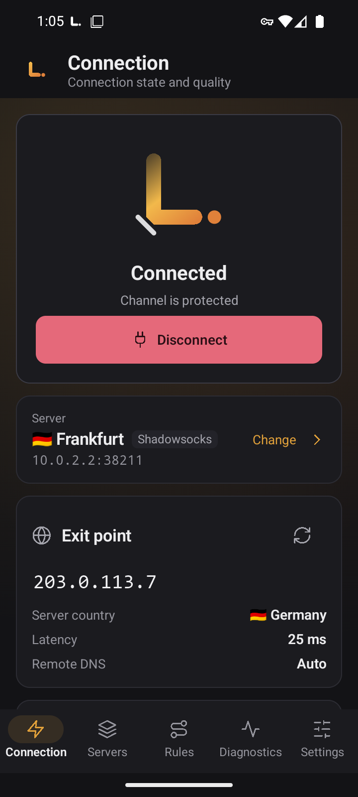
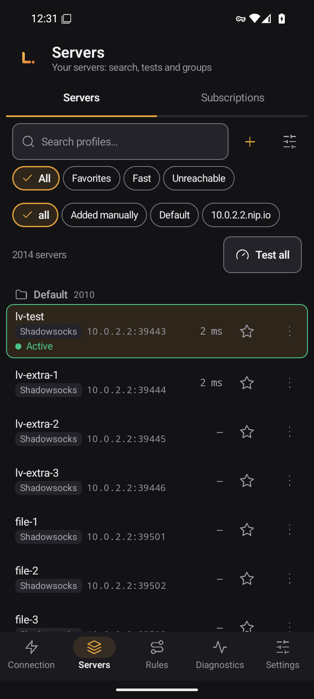
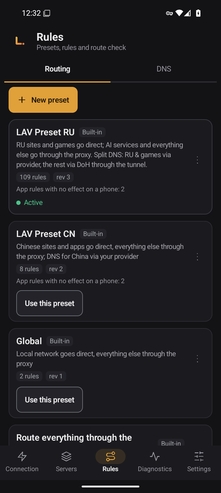
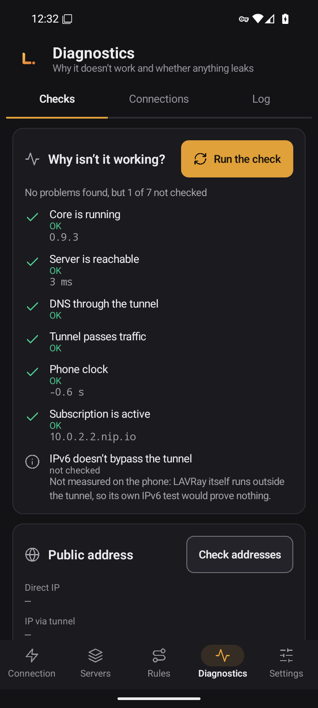
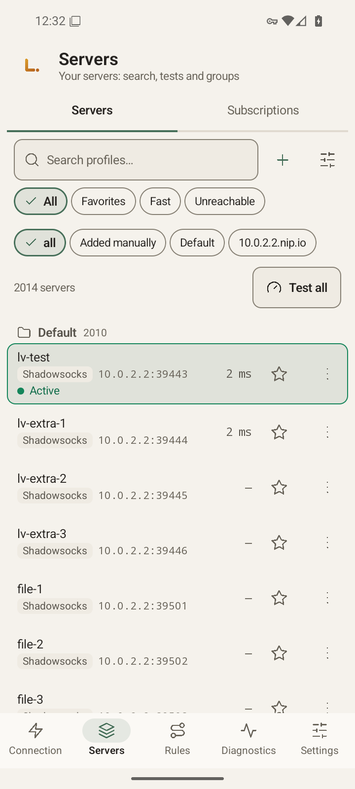
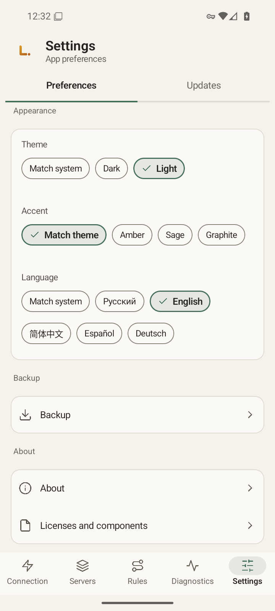

# LAVRay（Android 版）

[Русский](README.md) · [English](README.en.md) · **中文** · [Español](README.es.md) · [Deutsch](README.de.md)

*本文是俄语版 README 的译文，版本发布说明（Release Notes）为俄语。*

**LAVRay** Android 版是一款手机 VPN 客户端。它是用 Kotlin 和 Jetpack Compose 编写的原生应用，与 [LAVRay Windows 版](https://github.com/anatolijlaptev1991-ctrl/lavray-windows)使用同一个 Go 内核：名称、路由预设、界面和配色都保持一致。它连接您自己的服务器和订阅，默认不会向订阅提供商发送任何设备信息。

<p align="center">
  
  
  
</p>
<p align="center">
  
  
  
</p>

*截图来自模拟器，界面语言为英文。*

> **状态：0.9.3 版，尚未在真机上测试。** 应用只在 Android 16 模拟器（x86_64）上构建并检查过。真机测试清单见 [docs/PHONE-CHECKLIST.md](docs/PHONE-CHECKLIST.md)（俄语）。

## 功能

- **服务器与分组：** 搜索、收藏、“低延迟”和“不可达”筛选、排序、在分组间移动、复制，以及每个服务器的二维码。
- **订阅：** 按计划更新，可回滚到上一次成功的状态。
- **导入：** 链接、剪贴板、二维码（相机或图片）、文件。`vless://`、`vmess://`、`trojan://`、`ss://`、`hy2://`、`tuic://` 等链接可以从其他应用打开，或通过“分享”发给 LAVRay。在您确认之前不会导入任何内容。
- **延迟测试**（测试全部服务器）和 URL 测试。
- **路由预设：**“全局”“全部走代理”“全部直连”、**LAV Preset RU**（第 3 版，默认启用：俄罗斯网站和游戏直连，其余走代理）以及 LAV Preset CN。支持自建预设、导入导出，以及“检查路由”（某个地址会走哪条路）。
- **DNS**、**连接**、**日志**、**统计**，以及“为什么连不上？”检查页面。
- **按应用分流：** 所有应用、仅所选应用，或除所选之外的所有应用。
- **重启后自动连接**到上次使用的服务器，并支持系统的“始终开启的 VPN”。
- **备份**为加密文件，通过系统文件选择器保存。
- **五种界面语言**（Русский、English、中文、Español、Deutsch），浅色和深色主题，多种强调色。

支持的协议与桌面版相同：VLESS（含 REALITY）、VMess、Trojan、Shadowsocks、Hysteria2、TUIC、SOCKS、HTTP。

---

## 下载

首个版本发布后，APK 会出现在 [Releases](https://github.com/anatolijlaptev1991-ctrl/lavray-android/releases) 页面。每种 CPU 架构对应一个文件：

| 文件 | 适用设备 | 文件大小 |
|---|---|---|
| `LAVRay-<版本>-arm64-v8a.apk` | 几乎所有现代手机和平板 | 20.65 MB |
| `LAVRay-<版本>-armeabi-v7a.apk` | 较老的 32 位设备 | 21.24 MB |
| `LAVRay-<版本>-x86_64.apk` | 模拟器和 Chromebook | 21.97 MB |
| `SHA256SUMS` | 校验和 | — |

不确定选哪个时，请选 `arm64-v8a`。文件大小取自 [docs/MEASUREMENTS.md](docs/MEASUREMENTS.md)（俄语）。

**校验文件。** 把 APK 和 `SHA256SUMS` 下载到同一个文件夹：

```bash
sha256sum -c --ignore-missing SHA256SUMS      # Linux、macOS（macOS 上用：shasum -a 256 -c）
```

```powershell
Get-FileHash .\LAVRay-<版本>-arm64-v8a.apk -Algorithm SHA256   # Windows：与 SHA256SUMS 中对应的一行比对
```

**签名。** 发布版 APK 使用所有者的密钥签名，详见 [docs/SIGNING.md](docs/SIGNING.md)（俄语）。只有签名相同的 APK 才能覆盖安装已有的版本。

**系统要求：** Android 8.0 或更高版本（minSdk 26），ARM（64 位或 32 位）或 x86_64 处理器。

---

## 快速开始

1. **安装 APK。** 允许从所用来源（浏览器、“文件”应用）安装，打开文件并确认安装。
2. **添加服务器。**“连接”→“添加服务器”，或“服务器”→“+”图标。粘贴服务器或订阅链接，用相机扫描二维码，选择含二维码的图片，或选择文件。导入前会先显示将要添加的内容。
3. **连接。**“连接”→“连接”。Android 13 及更高版本会先询问通知权限（VPN 以前台服务运行并显示通知），然后弹出 VPN 授权对话框：两个都请允许。连接成功后，界面会显示出口国家和地址、泄漏检查和速度。
4. **检查路由。** LAV Preset RU 已经启用：俄罗斯网站直连，其余通过服务器。可在“规则”中换用其他预设。
5. **自动连接。**“设置”→“启动”→“手机启动时自动连接”（默认关闭）。细节和限制见下文。

---

## 使用方法

### 服务器与订阅

- “全部测试”会测量延迟。视图菜单里有“URL 测试”：通过每个服务器打开一个真实页面。测试期间当前连接不会中断。
- 服务器菜单：“连接”、收藏、“复制链接”、“分享链接”、“显示二维码”（链接中含有密钥，应用会给出提示）、“复制”、“移到分组…”、排序、删除。长按可多选服务器。
- 订阅：“订阅”→ 添加链接，再点“更新”。更新失败不会清掉旧服务器，还可以“回滚”。
- XHTTP 链接可以导入，但会标注“内核不支持”：无法通过它们连接。

### 规则与 DNS

- 内置预设不会被修改：“配置副本”会创建您自己的副本，“重置为原始预设”可恢复。
- “检查路由”会显示某个域名或 IP 在当前预设下的走向。
- DNS：“自动”（跟随当前预设）、本地、DoH、DoT、经隧道、自定义服务器、FakeIP。

### 诊断

- **检查**（“为什么连不上？”）：内核、服务器、隧道、DNS、时间、订阅。
- **连接：** 每条连接的地址、出站、规则和流量，支持搜索、暂停和关闭。
- **日志：**“复制”和“分享”给出的日志已隐藏密码、UUID、令牌和订阅地址，可以放心附在问题报告里。
- **统计：** 本次会话和历史累计流量，按分组和路由查看。

### 按应用分流

“设置”→“隧道”→“隧道中的应用”：所有应用、仅所选应用，或除所选之外的所有应用。LAVRay 自身始终不走隧道。修改在下次连接时生效。

### 设置

语言、主题和强调色、“连接后检查连通性”、隧道内的 IPv6、MTU、按地址排除、mux，以及跳转到系统“始终开启的 VPN”和电池设置的入口，还有备份、“关于”和许可证。隧道始终使用 gVisor，默认 MTU 为 9000，设置中不提供协议栈选项。

### 更新

“更新”页面只会打开发布页面。应用不会联网检查新版本，也不会自动更新：请下载新的 APK 并覆盖安装，数据会保留。

### 备份

“设置”→“备份”：把所有数据（含密码的服务器、分组、订阅、自建预设、设置）保存为一个 `.lavbk` 文件，并用您设置的密码加密。没有密码就无法打开。恢复会替换当前全部数据，且需要先断开 VPN。

---

## 开机自启、Always-on 与手机差异

- 打开“手机启动时自动连接”：重启后应用会连接到上次的服务器。Android 只会在手机**首次解锁之后**才发出开机完成信号。
- 如果手机启动时没有网络（例如处于飞行模式），应用会安静等待，网络出现后再连接。没有定时器，也不轮询。
- 最可靠的做法是使用系统的 **Always-on VPN（始终开启的 VPN）**。在 LAVRay 中依次进入“设置”→“系统”→“打开 VPN 设置”，会打开 Android 的 VPN 列表：点 LAVRay 旁边的齿轮，启用“始终开启的 VPN”，也可按需启用“阻止没有 VPN 的连接”（名称因手机而异）。LAVRay 看不到也无法修改这些开关。由系统启动应用时，LAVRay 将其视为 Always-on 启动，并连接上次的服务器。
- 被强制停止的应用，在您再次打开之前收不到开机信号。
- 各厂商的系统（小米/HyperOS、华为/HarmonyOS、三星、Oppo/Realme/OnePlus、Vivo）可能禁止自启动，或在熄屏后结束服务。这时请把 LAVRay 加入自启动和电池管理的白名单。详见 [docs/PHONE-CHECKLIST.md](docs/PHONE-CHECKLIST.md)（俄语）。
- 如果其他 VPN 应用抢走了授权，LAVRay 会弹出“需要 VPN 权限”的通知：请打开应用重新确认。

---

## 测量数据

所有数字都来自 [docs/MEASUREMENTS.md](docs/MEASUREMENTS.md)（俄语），是在 **x86_64 的 Android 16 模拟器（2 个 vCPU）上测得，而不是在手机上**。真机上的数值会不同。

| 指标 | 数值（模拟器） |
|---|---|
| APK 大小：arm64-v8a / armeabi-v7a / x86_64 | 20.65 / 21.24 / 21.97 MB |
| 界面冷启动，中位数 | 约 1.26 秒（1259.5 毫秒，16 次） |
| `:vpn` 进程空闲时的内存（已连接、熄屏） | 约 67 MB PSS |
| 空闲时的 wakelock、闹钟和任务 | 均没有 |
| 点击“连接”到隧道首次响应，中位数 | 844 毫秒（本地测试服务器） |
| MTU 9000 对比 1500 的隧道吞吐量 | 下行快 4.1 倍，上行快 2.4 倍（模拟器内部的测试环境，不是真实网络） |

未测量：电池消耗、真机速度、在 arm64 和 armeabi-v7a 上的运行情况。

---

## 隐私

很多订阅提供商会根据客户端发送的标识来限制设备数量。**LAVRay 默认不发送这类标识：**订阅请求中只有 User-Agent `LAVRay/<版本>`。如果提供商要求 HWID，可在订阅设置中打开“发送设备标识（HWID）”：发送的是为这次安装随机生成的标识，而不是手机的硬件信息。

相机只用于读取二维码。只有当您打开导入窗口时，应用才会读取剪贴板。应用选择列表只包含有启动图标的应用。本应用已关闭 Android 自带的应用备份。

---

## 尚不支持的功能

- **没有自动更新：** 新版本需从发布页面手动安装。
- **缺少部分桌面版功能**，包括服务器编辑器、“完整测试”和首次运行向导。完整清单及原因见 [docs/NOT-PORTED.md](docs/NOT-PORTED.md)（俄语）。
- **XHTTP 传输：** 链接可以导入，但内核暂不支持。
- **尚未在真机上测试。**

---

## 从源码构建

需要 JDK 21、带 NDK 28.2.13676358 的 Android SDK（平台 36）、Go（版本见 `third_party/lavray/core/go.mod`）和 Bash。

```bash
git clone --recurse-submodules https://github.com/anatolijlaptev1991-ctrl/lavray-android.git
cd lavray-android
bash scripts/build-core.sh        # Go 内核 -> app/libs/lavray-core.aar（gomobile bind）
./gradlew assembleRelease         # APK 位于 app/build/outputs/apk/release/
```

本地构建使用调试密钥签名，不能分发。正式版由 `release.yml` 在 `v*` 标签上构建，密钥说明见 [docs/SIGNING.md](docs/SIGNING.md)。代码结构见 [docs/ARCHITECTURE.md](docs/ARCHITECTURE.md)，技术选型见 [docs/STACK.md](docs/STACK.md)（均为俄语）。

## 报告问题

[创建 issue](../../issues/new/choose)：请说明您做了什么、预期结果是什么、实际发生了什么、手机型号、Android 版本、厂商系统、LAVRay 版本（“设置”→“关于”），以及日志（“诊断”→“日志”→“分享”）。

## 源代码与许可证

应用代码（Kotlin、Compose）和内核构建脚本在本仓库中。Go 内核和桌面版界面位于 [lavray](https://github.com/anatolijlaptev1991-ctrl/lavray)，以子模块 `third_party/lavray` 引入（标签 v0.9.3）。

许可证：[GPL-3.0-only](LICENSE)。LAVRay 基于 nekoray/NekoBox（GPL-3.0）和 sing-box（GPL-3.0 或更新版本）开发。
